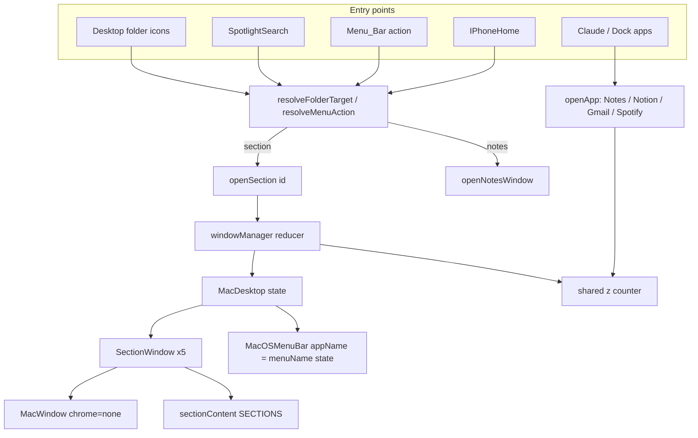

# Design Document

## Overview

The Finder window (`FinderApp`) is replaced by five independent Section Windows (about, experience, projects, skills, resume). Each has PostHog-inspired chrome built in this repository. The design has four parts:

1. **Shared content module.** `SECTIONS` and its types move out of `FinderApp.tsx` into `src/lib/sectionContent.ts`.
2. **Window manager.** A pure reducer in `src/lib/windowManager.ts` tracks open, minimized, focus, stacking and initial position for the five Section Windows. `MacDesktop` holds it with `useReducer`.
3. **Window frame.** `MacWindow` is reused for drag, resize, minimize and zoom. It gets four small optional props. Its geometry math moves to `src/lib/windowGeometry.ts` so it can be tested.
4. **Section Window component.** `SectionWindow` wraps `MacWindow` with `chrome="none"` and draws its own PostHog-style title bar. It uses the `useMacWindowChrome()` hook and the `data-mac-drag` handle that `FinderApp` already uses.

Every entry point (desktop folders, Spotlight, Menu_Bar, iPhone_Home, Dock) goes through one resolver and one `openSection(id)` handler.

Language: TypeScript / React (Next.js App Router, client components). Per `AGENTS.md`, the Next.js guides in `node_modules/next/dist/docs/01-app/01-getting-started/` (notably `05-server-and-client-components.md` and `11-css.md`) must be read before implementation. No new route or server code is needed: all new components are client components imported by the already-client `MacDesktop`.

### Design decisions

| Decision | Alternatives | Reason |
|---|---|---|
| Reuse `MacWindow` with `chrome="none"` and a custom title bar | Use `chrome="default"` (macOS traffic lights); write a new window component | `chrome="none"` already supports a child-supplied title bar via `data-mac-drag` and `useMacWindowChrome()`. Drag, resize, zoom and minimize are reused unchanged. |
| Pure reducer for window state | Several `useState` pairs per window as in `MacDesktop` today | Five windows with focus, stacking and cascade rules are error-prone with scattered state. A reducer is testable with property tests. |
| Shared monotonic z counter in a `useRef` | Keep `topZ` state and `bumpZ()` | `bumpZ()` reads stale state when called twice in one handler. A ref counter gives strictly increasing values and keeps Notes, Notion, Gmail and Section Windows on one stacking scale (Requirements 9.2, 9.3). |
| All windows live in one stacking container (`.mac-desktop__windows`, `z-index: 45`) | Raw window z-indexes above the Dock | Today `topZ` grows past the Dock's `z-index: 50`, so a window can cover the Dock. A container with its own stacking context keeps any window z-index below Menu_Bar (100) and Dock (50) and above folder icons (Requirement 3.4). |
| Maximize/restore stays inside `MacWindow` (`zoomed` state, CSS inset) | Store maximized in the reducer | The frame (`pos`, `size`) is not touched while zoomed, so restore is exact. The reducer does not need it. |
| One fixed layout per section | View switcher | Requirement 1.6. |

## Architecture



### Stacking

```text
Menu_Bar                      z 100  (existing)
Dock                          z 50   (existing)
.mac-desktop__windows         z 45   new stacking context, pointer-events: none
  ├─ Section Windows          z from shared counter (pointer-events: auto)
  ├─ Notes / Notion / Gmail   z from the same counter
Desktop folder icons          z 25   (existing)
```

Toast notifications, Notification Centre and Spotlight keep their existing z-indexes (53 to 55) and stay above the container. Spotify (`SpotifyApp`) is rendered outside the container, as it is today.

## Components and Interfaces

### `src/lib/sectionContent.ts` (new, shared content)

Moved verbatim from `FinderApp.tsx`: the `SECTIONS` array and the `FinderItem`, `FinderGroup`, `FinderSection` types, renamed to drop "Finder".

```ts
import { LINKS, type FolderId } from "@/lib/portfolioContent";

export type SectionId = Exclude<FolderId, "notes">;

export type SectionItem = {
  id: string;
  name: string;
  kind: "folder" | "file";
  detail: string;
  link?: string;
  icon?: string;
  role?: string;
  dates?: string;
  location?: string;
  highlights?: string[];
};
export type SectionGroup = { title: string; items: SectionItem[] };
export type Section = {
  id: SectionId;
  name: string;
  items: SectionItem[];
  groups?: SectionGroup[];
};

export const SECTION_IDS: readonly SectionId[] =
  ["about", "experience", "projects", "skills", "resume"];
export const SECTIONS: readonly Section[] = [/* unchanged data */];

export function getSection(id: SectionId): Section;
export function sectionItemsOf(section: Section): SectionItem[]; // groups flattened in order
export function experienceInfoRows(item: SectionItem):
  { label: string; value: string }[];          // Role, Company, Dates, Location, Website
export function isSectionId(id: string): id is SectionId;
```

The module has no JSX and no React import. `AboutBio` (the about layout) is rendered by `SectionWindow`, not stored in this module.

### `src/lib/portfolioContent.tsx` (edit)

`FOLDER_WINDOWS` is only used by `MacDesktop` for window titles and by nothing else, and it imports `AboutBio`, which imports `portfolioContent` back (an existing import cycle). `FOLDER_WINDOWS` is removed. Titles come from `SECTIONS[i].name`. `LINKS` and `FolderId` stay. The `FolderId` value `"notes"` stays so `IPhoneHome` and Spotlight keep working (Requirement 8.8).

### `src/lib/windowGeometry.ts` (new, extracted from `MacWindow`)

Pure functions, with behavior unchanged except for the minimum height.

```ts
export const MIN_W = 360;
export const MIN_H = 280;               // was 240; Requirement 4.4
export const MENUBAR_H = 36;
export const TITLEBAR_H = 40;           // section title bar height

export type Point = { x: number; y: number };
export type Size = { w: number; h: number };
export type Viewport = { w: number; h: number };
export type ResizeEdge = "n"|"s"|"e"|"w"|"ne"|"nw"|"se"|"sw";

export function clampPos(p: Point, size: Size, vp: Viewport): Point;
export function resizeFrame(
  edge: ResizeEdge,
  start: { pos: Point; size: Size },
  delta: Point,
  vp: Viewport,
  min?: Size,
): { pos: Point; size: Size };
```

`MacWindow` calls these in its `onMove` handlers instead of the inline code. Notes, Notion and Gmail also use `MacWindow`; their `MIN_H` changes from 240 to 280. This is a deliberate, small change and is the only effect on other apps. If that is unwanted, `MacWindow` takes `minHeight` as a prop (below) and Notes/Notion/Gmail keep 240. The design uses the prop: default stays 240, `SectionWindow` passes 280.

### `MacWindow.tsx` (edit, backward compatible)

New optional props. Existing callers need no change.

```ts
type MacWindowProps = {
  // existing props unchanged
  minWidth?: number;                 // default 360
  minHeight?: number;                // default 240; SectionWindow passes 280
  initialPosition?: Point;           // when set, used instead of centering on first open
  focused?: boolean;                 // default true; false adds class "is-inactive"
};
```

Behavior changes:

- On open, `initialPosition` (if provided and not mobile) replaces the centered position. Size is still `min(width, vw - 32)` by `min(height, vh - 140)`.
- `focused === false` adds `is-inactive` to the root element.
- Root `onMouseDown={onFocus}` becomes `onPointerDown={onFocus}` so touch and pen focus the window too. `beginDrag` and `beginResize` already call `onFocus` themselves and stop propagation, so there is no double call that matters (focus is idempotent).
- `clampPos`/resize use `windowGeometry`.
- Unchanged and reused: drag, 8-edge resize, minimize (window stays mounted with opacity 0 and `pointer-events: none`, so the content scroll position and the frame are kept), zoom (CSS inset between menu bar and Dock; the stored `pos`/`size` are restored on un-zoom), mobile auto-zoom on open (`vw <= 720`), reset of `zoomed` when `open` becomes false.

The zoomed state ignores drag and resize already (`beginDrag`/`beginResize` return when `zoomed`; resize handles are not rendered).

### `src/lib/windowManager.ts` (new, pure reducer)

```ts
import type { SectionId } from "@/lib/sectionContent";
import type { Point } from "@/lib/windowGeometry";

export type SectionWindowState = {
  open: boolean;
  minimized: boolean;
  z: number;          // stacking order, from the shared counter
  origin: Point;      // initial position given at open time
  slot: number;       // cascade slot, lowest unused among open windows
};

export type WindowManagerState = {
  windows: Record<SectionId, SectionWindowState>;
  focused: SectionId | null;      // null when no section window is focused
};

export type WindowAction =
  | { type: "open"; id: SectionId; z: number; base: Point }
  | { type: "focus"; id: SectionId; z: number }
  | { type: "minimize"; id: SectionId }
  | { type: "close"; id: SectionId }
  | { type: "blur" };             // another app took focus

export const CASCADE_STEP: Point = { x: 32, y: TITLEBAR_H };

export function initialState(z: number, base: Point): WindowManagerState; // about open + focused
export function reducer(s: WindowManagerState, a: WindowAction): WindowManagerState;
export function menuName(s: WindowManagerState): string;  // focused title or DEFAULT_APP_NAME
export function topVisible(s: WindowManagerState): SectionId | null;
```

Rules:

- `open(id)`: if the window is open, set `minimized = false`, `z = a.z`, `focused = id`, keep `origin` and `slot` (no second window). If closed, choose `slot` as the lowest integer in `0..4` not used by an open window, set `origin = base + slot * CASCADE_STEP`, `minimized = false`, `z = a.z`, `focused = id`.
- `focus(id)`: ignored if the window is closed or minimized; otherwise `z = a.z`, `focused = id`.
- `minimize(id)`: `minimized = true`. If it was focused, focus moves to `topVisible` (or `null`).
- `close(id)`: `open = false`, `minimized = false`. If it was focused, `focused = topVisible(next)`, which is the open, non-minimized window with the highest `z`, or `null`.
- `blur`: `focused = null`. Used when Notes, Notion, Gmail or Spotify becomes the Focused_Window, so Section Windows render inactive.
- Five slots with a vertical step equal to the title-bar height mean no open window can hide another's title bar (Requirement 3.6). `base` is computed by `MacDesktop` from the viewport (centered, shifted up by half the cascade depth) and clamped by `MacWindow`.

`DEFAULT_APP_NAME = "Portfolio"`. It replaces the hard-coded `"Finder"` in `setActiveApp("Finder")` calls and in the `MacOSMenuBar` `appName` default.

### `src/lib/entryPoints.ts` (new, pure resolvers)

```ts
export type FolderTarget =
  | { kind: "section"; id: SectionId }
  | { kind: "notes" };

export function resolveFolderTarget(id: FolderId): FolderTarget;
export function resolveMenuAction(action: string):
  | { kind: "section"; id: SectionId }
  | { kind: "spotlight" }
  | { kind: "none" };
```

- `resolveFolderTarget("notes")` returns `{ kind: "notes" }`; the five Section_Ids return `{ kind: "section", id }`.
- `resolveMenuAction`: `about` returns section `about`; `new-finder` returns section `projects`; `find`, `search-help`, `open-location` return `spotlight`; everything else returns `none`. The action id `new-finder` is a Menu_Bar identifier and keeps its name; only the behavior changes.

### `src/components/SectionWindow.tsx` (new)

```ts
type SectionWindowProps = {
  section: Section;
  windowState: SectionWindowState;
  focused: boolean;
  zIndex: number;
  onClose(): void;
  onMinimize(): void;
  onFocus(): void;
};
```

It renders:

```tsx
<MacWindow
  open minimized={windowState.minimized} focused={focused}
  title={section.name} chrome="none" variant="light"
  width={760} height={520} minWidth={360} minHeight={280}
  initialPosition={windowState.origin}
  zIndex={zIndex} className={`mac-window--section ph-window ph-window--${section.id}`}
  bodyClassName="ph-window__body"
  onClose={onClose} onMinimize={onMinimize} onFocus={onFocus}>
  <SectionChrome section={section} />
</MacWindow>
```

`SectionChrome` (same file) uses `useMacWindowChrome()`:

- **Title bar** (`data-mac-drag`, height `TITLEBAR_H`, `onDoubleClick` calls `chrome.onToggleZoom()` unless the event target is inside `[data-no-drag]`). Left: section icon (`IconAbout`, `IconExperience`, `IconProjects`, `IconSkills`, `IconResume` from `FinderIcons`), then the title text. Right: three `data-no-drag` buttons, minimize, maximize/restore, close, each with `data-ui-sound="click"` and an `aria-label`. Controls are lucide icons (`Minus`, `Square`/`Copy`, `X`), already a dependency.
- **Content area** (`.ph-window__content`, `overflow-y: auto`, chrome stays fixed above it).

Fixed layouts, one per section:

| Section | Layout | Data |
|---|---|---|
| about | `<AboutBio showLinks />` in a padded column | `AboutBio` |
| experience | Left list of roles (icon + company) and right detail pane with Information rows and Work highlights | `SECTIONS[experience].items`, `experienceInfoRows` |
| projects | Card list: icon, name, detail, link | items |
| skills | Grouped tile grid; group title, tile icon + name; selected tile's detail shows in a strip below the grid | groups |
| resume | Card list as projects | items |

The experience and tile behaviors (select on click, `window.open(link)` on double-click, `data-ui-sound="click"`) are carried over from `FinderApp`. Selection state is local to `SectionChrome`, so minimizing and restoring keep it (the window stays mounted).

Fallback for item icons is `IconFolderLarge`, as in `FinderIconButton` today.

### PostHog-inspired styling (`mac-desktop.css`)

A new `.ph-window` block replaces the `.mac-window--finder` / `.mac-finder*` rules. All values live in CSS custom properties on `.ph-window`:

```css
.ph-window {
  --ph-bg: #eeefe9;        /* cream canvas */
  --ph-surface: #fdfdf8;
  --ph-ink: #151515;
  --ph-muted: #6b6b64;
  --ph-border: #cfd1c6;
  --ph-accent: #f54e00;    /* orange */
  --ph-yellow: #f9bd2b;
  --ph-blue: #1d4aff;
  font-family: ui-sans-serif, system-ui, -apple-system, "Segoe UI", sans-serif;
  border: 1.5px solid var(--ph-ink);
  border-radius: 8px;
  box-shadow: 4px 4px 0 var(--ph-ink);   /* hard offset shadow */
}
.ph-window.is-inactive { box-shadow: 2px 2px 0 var(--ph-border); border-color: var(--ph-border); }
.ph-window.is-inactive .ph-titlebar { background: var(--ph-bg); color: var(--ph-muted); }
```

Rules that apply:

- No PostHog logo, hedgehog, wordmark or asset. No PostHog package is added; the palette is chosen colors and system fonts only (Requirement 2.2, 2.3).
- `.ph-window__content { overflow-y: auto; min-height: 0; }` with a flex column body so the title bar stays fixed (Requirement 6.5).
- `@media (max-width: 720px)` keeps the existing `.mac-window.is-zoomed` behavior.
- `.mac-desktop__windows { position: absolute; inset: 0; z-index: 45; pointer-events: none; }` and `.mac-desktop__windows > * { pointer-events: auto; }`. Because `MacWindow` sets `pointer-events: none` when minimized and `auto` otherwise inline, the inline value wins for windows.

### `MacDesktop.tsx` (edit)

State and handlers:

- Remove `openFolder`, `folderMinimized`, `folderZ`, `focusFolder`, `openFolderWindow`, `closeFolderWindow`, the `finder` entry in `DOCK_APPS`, the `FinderApp` element and the `FOLDER_WINDOWS` import.
- Add `const zRef = useRef(48); const nextZ = () => ++zRef.current;` replacing `topZ`/`bumpZ`. `focusNotes`, `focusNotion` and `focusMail` call `nextZ()` and additionally dispatch `{ type: "blur" }`.
- Add `const [wm, dispatch] = useReducer(reducer, undefined, () => initialState(nextZ(), computeBase()))`. The initial state has `about` open and focused (Requirement 8.7).
- `openSection(id)`: `dispatch({ type: "open", id, z: nextZ(), base: computeBase() })`, `setActiveApp(getSection(id).name)`. It replaces `openFolderWindow`.
- `activeApp` initial value is `"About Me"`, which equals `menuName(initialState)`. After a Section Window closes or minimizes, `activeApp` is set from the reducer's next focus: `menuName(next)`. Because `dispatch` is asynchronous, `MacDesktop` derives the Section part with `useEffect` on `wm.focused`: when `wm.focused` changes to a section id, `setActiveApp(title)`; when it becomes `null` and no other app window is focused, `setActiveApp(DEFAULT_APP_NAME)`. Notes, Notion and Gmail set `activeApp` themselves when focused as today.
- `closeNotes`, `closeNotion`, `closeMail`, `closeSpotify` replace `setActiveApp("Finder")` with `setActiveApp(topVisible(wm) ? getSection(topVisible(wm)!).name : DEFAULT_APP_NAME)` and, if a section is visible, dispatch `focus` for it.
- `openApp`: the `finder` branch is deleted. `claude`, `github`, `x`, `linkedin` are unchanged.
- Entry points:
  - Desktop_Folder_Icons: `onOpen={() => openSection(folder.id)}`. `DESKTOP_FOLDERS` is derived from `SECTIONS` (`id`, `name`).
  - Spotlight: items for folders use an icon from `SECTION_ICON_SRC[id]` (the five `/icons/finder/sidebar-*.png` paths, exported from `FinderIcons.tsx` next to the icon components), replacing the Finder dock icon. `handleSpotlightSelect` calls `resolveFolderTarget`; sections call `openSection`, notes calls `openNotesWindow`. The existing Spotlight component closes itself on select; the `setSpotlightOpen(false)` call is kept explicit in `handleSpotlightSelect` for folder results (Requirement 8.2).
  - Menu_Bar: `handleMenuAction` uses `resolveMenuAction`.
  - iPhone_Home: `handleIPhoneOpen` for `type: "folder"` uses `resolveFolderTarget`; `type: "app"` keeps `openApp(action.id)`. `IPhoneHome.tsx` itself needs no change, but any `app` action with `id: "finder"` there must be re-pointed to a folder action (checked during implementation; see Error Handling).
- Render: one `.mac-desktop__windows` container wraps the five `SectionWindow` elements (mapped over `SECTIONS`), `NotesApp`, `NotionApp` and `MailApp`. Each `SectionWindow` gets `zIndex={wm.windows[id].z}` and `focused={wm.focused === id}`.
- `ToastNotifications` `paused` prop unchanged.

### Other edits

| File | Change |
|---|---|
| `FinderApp.tsx` | Deleted. `SECTIONS` moves to `sectionContent.ts`; `ExperienceGallery`, `FinderIconButton` logic moves into `SectionWindow.tsx`. |
| `FinderIcons.tsx` | Keep sidebar icons and `IconFolderLarge`. Remove `IconViewIcons`, `IconViewList`, `IconViewColumns`, `IconViewGallery` (only Finder used them). Add `SECTION_ICON_SRC`. |
| `mac-desktop.css` | Remove `.mac-window--chrome-none`/`.mac-finder-body` generic rules only if unused after the change (they are reused by `chrome="none"`, so keep `.mac-window--chrome-none .mac-window__body` and drop `.mac-finder-body`), `.mac-window--finder` and all `.mac-finder*` rules (lines ~1241 to the end of the finder block). Add `.ph-*` and `.mac-desktop__windows` rules. |
| `ui/mac-os-menu-bar.tsx` | Default `appName` `"Finder"` becomes `DEFAULT_APP_NAME`. Menu item labels are not changed. |
| `NotesApp.tsx` line 31 | "Folders on the right open Finder windows." becomes "Folders on the right open section windows." |
| `NotionApp.tsx` lines 87, 166, 251 | "Finder is the quick map" becomes "The section windows are the quick map"; "Spotlight, Finder, Notes" becomes "Spotlight, section windows, Notes"; same for line 251. |

## Data Models

```ts
type SectionId = "about" | "experience" | "projects" | "skills" | "resume";

type SectionWindowState = {
  open: boolean; minimized: boolean; z: number;
  origin: { x: number; y: number }; slot: number;   // slot in 0..4
};

type WindowManagerState = {
  windows: Record<SectionId, SectionWindowState>;
  focused: SectionId | null;
};
```

Invariants:

1. `focused !== null` implies `windows[focused].open && !windows[focused].minimized`.
2. `focused`, when set, has the highest `z` among all windows touched by an action since the last `blur` (it is raised on every open/focus).
3. Open windows have pairwise distinct `slot` values, so their `origin.y` values differ by at least `CASCADE_STEP.y`.
4. Closed windows keep no meaningful `origin`; the next `open` recomputes it.

`z` values come from the shared counter and strictly increase over time.

## Error Handling

| Situation | Handling |
|---|---|
| `open`/`focus`/`minimize`/`close` for a closed window | Reducer returns the state unchanged for `focus`, `minimize`, `close`; `open` opens it. |
| Unknown `FolderId` or non-section Spotlight id | `resolveFolderTarget` returns `notes` only for `"notes"`. For any other unknown string, `handleSpotlightSelect` does nothing (as `if (folderId in FOLDER_WINDOWS)` does today). |
| `IPhoneHome` still references a Finder app action | During implementation, grep `IPhoneHome.tsx` for `id: "finder"` and convert it to `{ type: "folder", id: "about" }`; there is no Finder dock id left for `openApp` to match. `openApp("finder")` then falls through to the external-link lookup and does nothing. |
| Viewport smaller than window | `MacWindow` already caps initial size to `vw - 32` by `vh - 140` and `clampPos` keeps the title bar visible. On `vw <= 720` the window opens zoomed. |
| Viewport is resized across the mobile breakpoint after opening | Out of scope. The breakpoint is checked on open, as for the existing windows. |
| Missing item icon image | Fall back to `IconFolderLarge`, as `FinderIconButton` does. |
| Double-click on window controls | `onDoubleClick` ignores events whose target is inside `[data-no-drag]`. |
| Stale state in handlers | The z counter is a ref and the reducer receives `z` in the action, so two dispatches in one handler never share a z value. |

## Testing Strategy

The repository has no test runner. The implementation adds `vitest` and `fast-check` as dev dependencies, with a `"test": "vitest --run"` script, tests under `src/**/*.test.ts`, and `jsdom` plus `@testing-library/react` only for the few component examples. Pure modules (`windowManager`, `windowGeometry`, `entryPoints`, `sectionContent`) have no browser dependency.

**Property tests** (fast-check, at least 100 runs each) cover the pure modules and use the tag format `Feature: posthog-style-windows, Property N: <text>`.

**Unit / example tests**:

- Initial state: only `about` open and focused (8.7). `DOCK_APPS` ids equal the previous list minus `finder` (7.1, 7.3).
- `SectionWindow` renders: title text, section icon, three controls, `data-ui-sound="click"` on controls and items (2.1, 2.4, 9.4); about window shows `AboutBio` with the links row (6.2); no resize handles and no drag when zoomed (4.5); pointer down on a control does not add `is-dragging` (4.6); double-click on the title bar toggles `is-zoomed` (5.5); zoom twice restores the frame style (5.3, 5.4); closing resets zoom on reopen (5.8); `innerWidth = 700` opens zoomed (4.7); `focused={false}` adds `is-inactive` (3.5).

**Smoke checks**: `npm run lint` and `npm run build` pass (9.5); `grep -ri finder src` has no references except allowed ones (the `new-finder` action id, `/icons/finder` asset paths, `FinderIcons` file name, the `finder` icon directory); no `posthog` package or asset in `package.json` or `public/` introduced by this change (2.3; the existing `/icons/stack/posthog.png` skill tile is portfolio content and stays); `SECTIONS` is defined once (6.4); `.ph-window__content` has `overflow-y: auto` (6.5); CSS z-index order is 100 > 50 > 45 > 25 (3.4).

## Correctness Properties

*A property is a characteristic or behavior that should hold true across all valid executions of a system-essentially, a formal statement about what the system should do. Properties serve as the bridge between human-readable specifications and machine-verifiable correctness guarantees.*

Reflection on redundancy: opening-related criteria (1.3, 1.4, 1.5, 3.2, 5.7) collapse into Property 1. Raise-on-press criteria (3.1, 9.2, 9.3) collapse into Property 2. Close (5.1) and refocus (5.6) collapse into Property 5. Minimize and restore (5.2, 5.7) and reopen reset (5.8) stay separate because they check different state (minimize keeps the frame, close discards it). Entry-point criteria (8.1 to 8.6, 8.8) collapse into Property 12.

### Property 1: Opening a section focuses exactly one window for it

For any reachable window manager state and any Section_Id, applying `open(id)` yields a state in which exactly one window exists for `id`, it is open and not minimized, it is the focused window, its `z` is greater than the `z` of every other window, and the set of other open windows is unchanged. Opening any sequence of Section_Ids leaves every one of those ids open.

**Validates: Requirements 1.3, 1.4, 1.5, 3.2, 5.7**

### Property 2: Focus raises above everything, including other apps

For any sequence of interleaved section `open`/`focus` actions and other-app focus events that draw `z` values from the shared counter, the window that most recently opened or was focused has a `z` greater than every other section or app window.

**Validates: Requirements 3.1, 9.2, 9.3**

### Property 3: Menu bar name follows the focused window

For any reachable state, `menuName(state)` equals the title of the focused Section_Window when one is focused, and `DEFAULT_APP_NAME` otherwise, and is never `"Finder"`.

**Validates: Requirements 3.3, 8.7**

### Property 4: Cascade keeps every open title bar visible

For any sequence of `open` and `close` actions, the open windows have pairwise distinct slots, and for any two open windows the vertical difference between their `origin` values is at least `TITLEBAR_H`.

**Validates: Requirements 3.6**

### Property 5: Closing refocuses the topmost visible window

For any reachable state and any open window `id`, applying `close(id)` makes `id` not open, and the resulting focused window is the open, non-minimized window with the highest `z`, or `null` (so the menu name is the default) when none remains. If `id` was not focused, the focused window does not change.

**Validates: Requirements 5.1, 5.6**

### Property 6: Minimize then open round trip keeps the frame

For any reachable state and any open window `id`, applying `minimize(id)` then `open(id)` yields a window that is open, not minimized, focused, and has the same `origin` and `slot` as before.

**Validates: Requirements 5.2, 5.7**

### Property 7: Close then open resets the window

For any reachable state and any open window `id`, applying `close(id)` then `open(id)` yields a window that is not minimized and whose `origin` equals the slot-derived origin for the slot it receives, regardless of where it was before.

**Validates: Requirements 5.8**

### Property 8: Dragging keeps the title bar visible

For any pointer position, window size and viewport size, `clampPos` returns a position whose `y` is at least the menu bar height and whose title bar lies within the viewport horizontally and vertically (the result is within `[8, vw - w - 8]` horizontally when the window fits).

**Validates: Requirements 4.1, 4.2**

### Property 9: Resizing respects the minimum size and the viewport

For any edge, starting frame, pointer delta and viewport, `resizeFrame` returns a size with `w >= minWidth` and `h >= minHeight` (360 and 280 for Section Windows), `w` no more than the viewport width minus 16, `h` no more than the viewport height minus 44, and for an `e` or `s` edge within those limits the new size equals the start size plus the delta.

**Validates: Requirements 4.3, 4.4**

### Property 10: Sections cover every id exactly once and keep their items

For all Section_Ids, `SECTIONS` contains exactly one section with that id; item ids within a section are unique; `sectionItemsOf` returns the items of a grouped section as the concatenation of its groups in order; and every item has a non-empty name and detail.

**Validates: Requirements 1.1, 6.1**

### Property 11: Experience details show every field

For any experience item, `experienceInfoRows(item)` includes a row for each of role, company, dates and location that is defined on the item, and a website row whose value is the link without scheme or trailing slash when a link is defined; no row has an empty value.

**Validates: Requirements 6.1**

### Property 12: Entry points resolve to the matching window

For any `FolderId`, `resolveFolderTarget` returns `{ kind: "section", id }` with the same id for each of the five Section_Ids and `{ kind: "notes" }` for `"notes"`. For any Menu_Bar action string, `resolveMenuAction` returns section `about` for `about`, section `projects` for `new-finder`, `spotlight` for `find`, `search-help` and `open-location`, and `none` for every other string.

**Validates: Requirements 8.1, 8.2, 8.3, 8.4, 8.5, 8.6, 8.8**
